# Architecture

This document describes the internals of `@leptoquark1/openage-pfadfinder`: its domains, dependencies, data flows,
design patterns and the contracts between components. For signatures, see the [API Reference](API.md).

As of commit `1c9febe`.

## Contents

1. [Overview](#1-overview)
2. [System context and dependencies](#2-system-context-and-dependencies)
3. [Domains and modules](#3-domains-and-modules)
4. [Data model](#4-data-model)
5. [Runtime collaboration](#5-runtime-collaboration)
6. [Caching and invalidation](#6-caching-and-invalidation)
7. [Design patterns](#7-design-patterns)
8. [Contracts and invariants](#8-contracts-and-invariants)
9. [Known limits and legacy API](#9-known-limits-and-legacy-api)
10. [The demo as a reference consumer](#10-the-demo-as-a-reference-consumer)
11. [Build, quality and release](#11-build-quality-and-release)
12. [Where does a change belong?](#12-where-does-a-change-belong)

## 1. Overview

The package plans movement for many units on large tile maps. It is a TypeScript port of the
[openage](https://github.com/SFTtech/openage) pathfinding subsystem, based on _Crowd Pathfinding and Steering Using
Flow Field Tiles_ by Elijah Emerson.

Instead of searching a cell path per unit, it works in two stages:

1. **High level:** an A\* search on the portal graph decides which sectors the route passes through.
2. **Low level:** each sector on the route gets a flow field that assigns a movement direction to every cell.

A unit then only has to look up the direction of the cell it stands on. Any number of units share the same fields, and
the fields of transit sectors can even be reused between different targets.

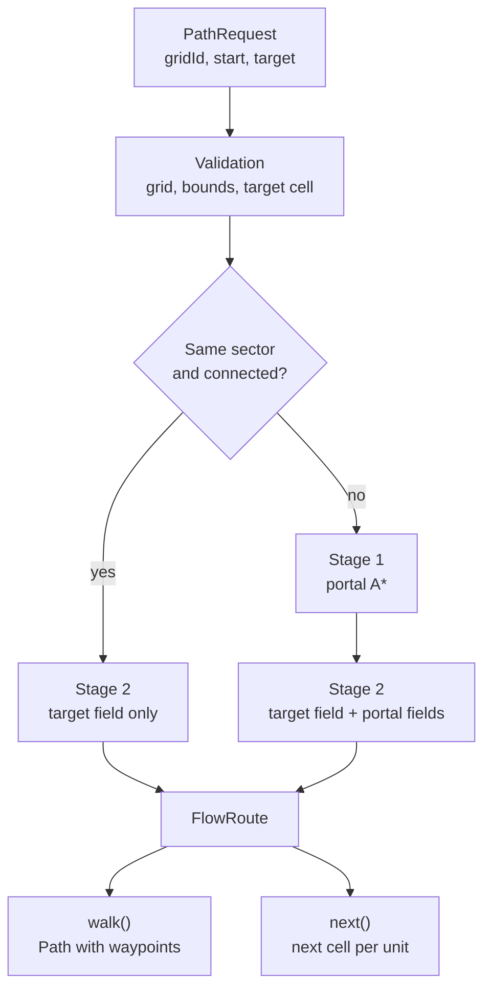

### Terminology

| Term                    | Meaning                                                                                  |
| ----------------------- | ---------------------------------------------------------------------------------------- |
| **Cell (tile)**         | Smallest map unit, addressed as `{ ne, se }`.                                            |
| **Sector**              | Square section of the map with its own cost field.                                       |
| **Grid**                | Rectangular arrangement of equally sized sectors.                                        |
| **Portal**              | Contiguous stretch of a sector border that is passable on both sides.                    |
| **Area**                | Group of 4-connected passable cells within one sector.                                   |
| **Cost field**          | Movement cost per cell.                                                                  |
| **Integration field**   | Accumulated cost from each cell to the field's target.                                   |
| **Flow field**          | Movement direction per cell, derived from the integration field.                         |
| **Line of sight (LOS)** | The cell can see the target in a straight line.                                          |
| **Wavefront-blocked**   | Cell in the shadow of an obstacle. The LOS wave ends here and the cost wave starts here. |
| **Route**               | Chain of sectors with one flow field each (`FlowRoute`).                                 |

### Coordinates

The package uses three kinds of addresses. `ne` is the east/west axis (x), `se` the south/north axis (y, growing
towards the south). Cells and sectors are numbered row-major.

```text
Grid 4 sectors wide, sector size 8, global cell (ne = 19, se = 12)

Sector position  x = ⌊19 / 8⌋ = 2       y = ⌊12 / 8⌋ = 1
Sector id        2 + 1 × 4 = 6
Local cell       ne = 19 % 8 = 3        se = 12 % 8 = 4
Cell index       3 + 4 × 8 = 35
```

## 2. System context and dependencies

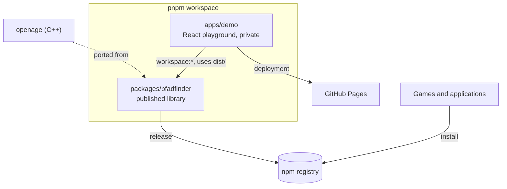

### External dependencies

The library has **no runtime dependencies** and no peer dependencies. It only relies on ES2022/ES2023 language
features, including typed arrays, `WeakMap` and `WeakRef`. Exact versions are in the `package.json` files.

| Scope     | Dependency                                    | Purpose                        |
| --------- | --------------------------------------------- | ------------------------------ |
| Library   | `typescript`                                  | Build and type checking        |
| Library   | `vitest`, `@vitest/coverage-v8`, `vite`       | Tests and coverage             |
| Library   | `publint`, `@arethetypeswrong/cli`            | Validation of the package      |
| Library   | `@types/node`                                 | Types for the benchmark script |
| Workspace | `@biomejs/biome`                              | Linting and formatting         |
| Workspace | `@changesets/cli`                             | Versioning and changelog       |
| Demo      | `react`, `react-dom`, `lucide-react`          | User interface                 |
| Demo      | `vite`, `tailwindcss`, `@vitejs/plugin-react` | Build and styling              |

### Public entry points

The package is ESM-only and declares `sideEffects: false`.

| Subpath | Source         | Contents                                                                                   |
| ------- | -------------- | ------------------------------------------------------------------------------------------ |
| `.`     | `src/index.ts` | Fields, graph, pathfinding, types, enums, constants, bit and coordinate helpers, cost maps |

Two properties are easy to miss:

- `src/shared/index.ts` is an internal barrel that the main entry re-exports. It is not a package subpath, so
  `PathResult`, `FlowDir` and `COST_*` always come from `.`.
- The barrel is not a leaf module at runtime. Because `buildGrid` lives there, it also loads `Grid`, `Sector`, `Portal`,
  `CostField`, `PortalNode` and the heap. Bundlers drop unused parts thanks to `sideEffects: false`, Node always loads
  them.

`IntrusiveHeap` and `PortalSearchNode` are deliberately not exported. `BinaryHeap` and `bresenhamLine` live in
`lib/internal` but stay public for compatibility.

## 3. Domains and modules

| Domain               | Path                  | Responsibility                                | Building blocks                                                      |
| -------------------- | --------------------- | --------------------------------------------- | -------------------------------------------------------------------- |
| **Shared kernel**    | `src/shared`          | Common vocabulary without domain logic        | `types`, `constants`, `bit-ops`, `coordinates`                       |
| **Cost map adapter** | `src/shared/cost-map` | Bridge from one global cost array to a `Grid` | `buildGrid`, `reachableFrom`, `nearestReachable`                     |
| **Field pipeline**   | `src/lib/core`        | Computing the fields of a sector              | `CostField`, `IntegrationField`, `FlowField`, `Integrator`           |
| **Spatial graph**    | `src/lib/graph`       | Map structure and its incremental upkeep      | `Grid`, `Sector`, `Portal`                                           |
| **Pathfinding**      | `src/lib/pathfinding` | Requests, search, routes, field cache         | `Pathfinder`, `portalAStar`, `PortalNode`, `FlowRoute`, `FieldCache` |
| **Internals**        | `src/lib/internal`    | Algorithms without domain knowledge           | `IntrusiveHeap`, `BinaryHeap`, `bresenhamLine`                       |

### Dependencies between domains

Solid arrows are runtime imports, dashed arrows are type-only imports (`import type`).

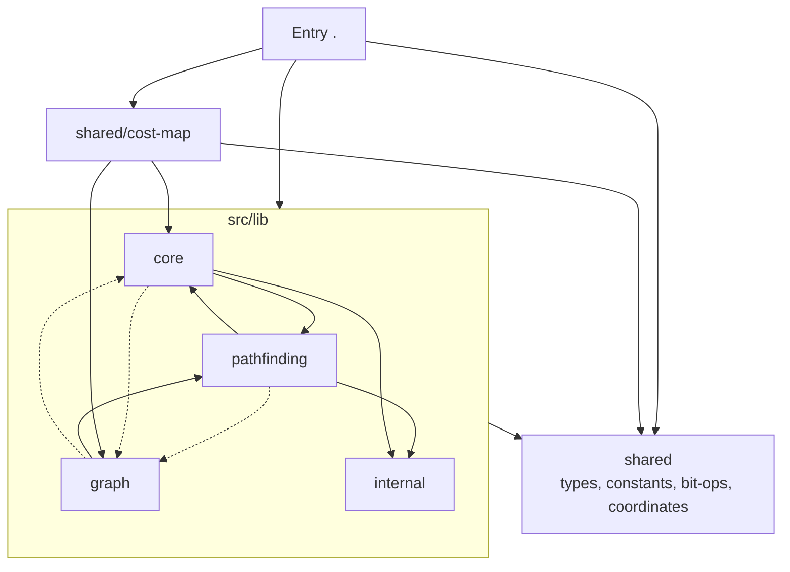

### Dependencies between files

The diagram shows all runtime imports within `lib` and from the cost map adapter. Imports of `shared` are left out
because almost every file has them.

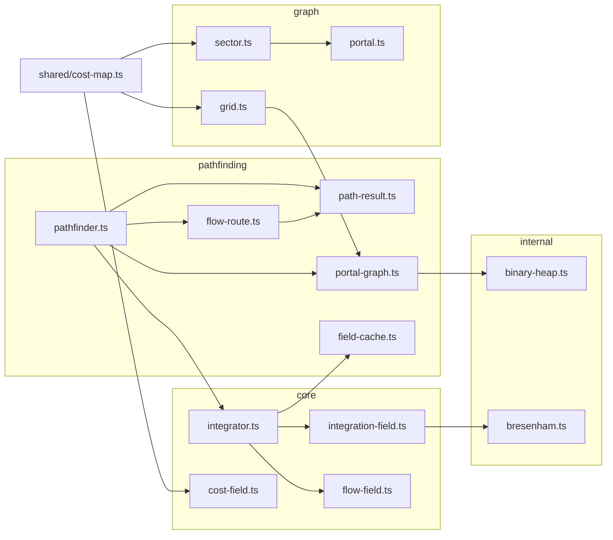

The import graph has these properties:

- **No runtime cycles between files.** Module initialization order is therefore not critical.
- **One cycle through types:** `grid.ts` creates `PortalNode` at runtime, `portal-graph.ts` knows `Grid` only as a type.
- **Folders are not strict layers.** Three runtime edges run against the obvious layering:

| Edge                                          | Reason                                                           |
| --------------------------------------------- | ---------------------------------------------------------------- |
| `core/integrator` → `pathfinding/field-cache` | The integrator owns its cache, which lives with the route parts. |
| `graph/grid` → `pathfinding/portal-graph`     | The grid maintains the `PortalNode` objects of the search graph. |
| `shared/cost-map` → `lib/core`, `lib/graph`   | The adapter builds complete grids but lives in `src/shared`.     |

These edges are where a cycle is most likely to appear when moving code. For example, `portal-graph.ts` must import
`Grid` as a type only, and `field-cache.ts` must not import `integrator.ts` at runtime.

## 4. Data model

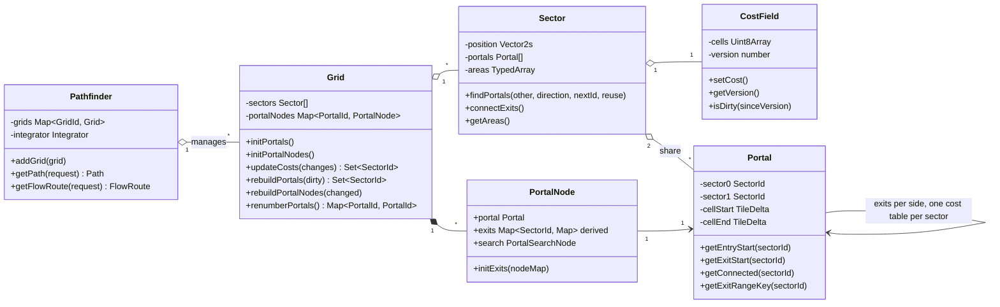

The computed fields, their cache and the routes form the second part of the model:

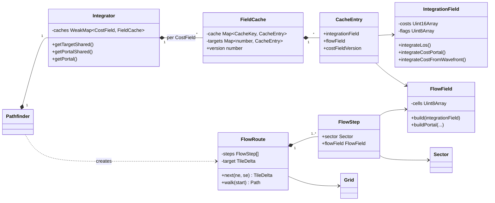

Three points matter for object lifetimes:

- A `Portal` knows its sectors **by id** only, so there is no object cycle between `Sector` and `Portal`.
- A `FieldCache` is released with its `CostField`, because the integrator holds it in a `WeakMap`.
- A `FlowRoute` holds **strong references** to its fields. It stays usable after the cache was cleared, but then shows
  the old state of the map (see [contracts](#8-contracts-and-invariants)).

### Memory layout of the fields

All fields are flat typed arrays with `size × size` entries.

| Field              | Storage       | Value range                                                         |
| ------------------ | ------------- | ------------------------------------------------------------------- |
| `CostField`        | `Uint8Array`  | `1` default, up to `254` expensive, `255` impassable. `0` passable. |
| `IntegrationField` | `Uint16Array` | `0` to `65534`, clamped there. `65535` means "not reached".         |
| `IntegrationField` | `Uint8Array`  | Flags per cell                                                      |
| `FlowField`        | `Uint8Array`  | 4 bits direction and 4 bits flags                                   |

| Bit | Value  | Integration field   | Flow field                         |
| --- | ------ | ------------------- | ---------------------------------- |
| 0   | `0x01` | –                   | Direction `FlowDir` (mask `0x0F`)  |
| 1   | `0x02` | `FOUND`             | Direction                          |
| 2   | `0x04` | `WAVEFRONT_BLOCKED` | Direction                          |
| 3   | `0x08` | –                   | Direction (currently always `0`)   |
| 4   | `0x10` | –                   | `PATHABLE`                         |
| 5   | `0x20` | `LOS`               | `LOS`                              |
| 6   | `0x40` | `TARGET`            | `TARGET`                           |
| 7   | `0x80` | –                   | –                                  |

`LOS` and `TARGET` occupy the same bits in both fields. `FlowField.build()` therefore transfers them with a single mask
(`flags & FLOW_FLAGS_MASK`), while the bits only relevant to integration drop out.

### Portal entry and exit

The portal API is relative to the sector you pass in. `Entry` lies **in** that sector, `Exit` **in the other one**.

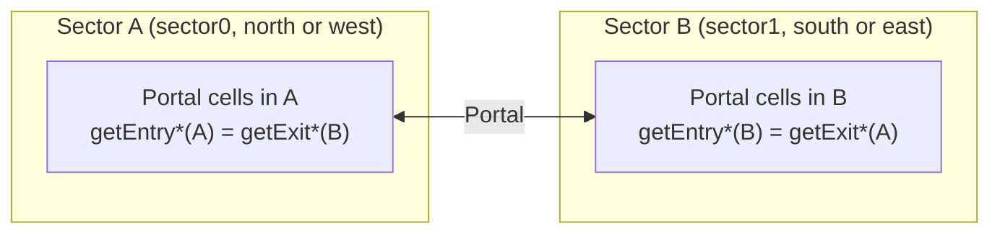

This explains a call that looks surprising at first: for the field in sector `S` that leads to neighbor `N`, integration
calls `portal.getExitStart(N)` and thereby gets the portal cells **in `S`**.

## 5. Runtime collaboration

### 5.1 Building a grid

`buildGrid()` wraps construction from one global cost array. Building a grid by hand takes the same steps in the same
order.

```mermaid
sequenceDiagram
    actor App
    participant Build as buildGrid
    participant Grid
    participant Sector
    participant Node as PortalNode

    App->>Build: buildGrid(costs, size, sectorSize)
    loop each sector, row-major
        Build->>Sector: new Sector(id, position, costField)
        Build->>Grid: addSector(sector)
    end
    Build->>Grid: initPortals()
    loop each sector
        Grid->>Sector: findPortals(below / right)
        Sector-->>Grid: one portal per passable stretch
        Grid->>Sector: addPortal() on both sides
        Grid->>Sector: connectExits()
        Note over Sector: Portals in the same area become exits<br/>of each other, costs in one table per sector
    end
    Build->>Grid: initPortalNodes()
    loop each portal
        Grid->>Node: new PortalNode(portal)
    end
    Grid->>Node: initExits(nodeMap)
    Note over Node: Limits exits to the node map;<br/>costs stay in the sector tables
    Build-->>App: Grid
```

### 5.2 Path request flow

`getPath()` and `getFlowRoute()` share `planRoute()`. The only difference is whether the route is walked once afterwards.

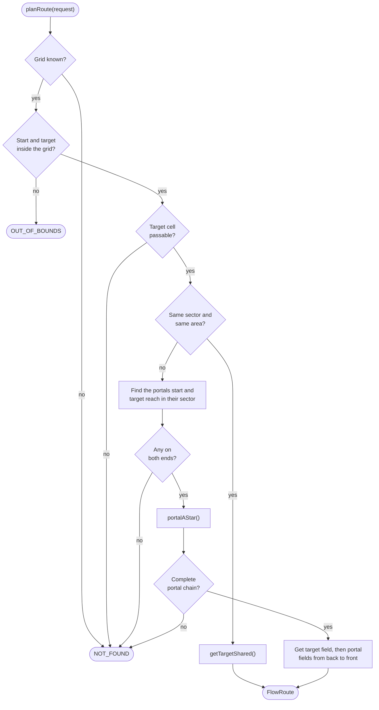

A sector split by a wall deliberately takes the portal branch. The route can leave it and come back, so the same sector
then appears twice in the route (for example `[0, 1, 0]`).

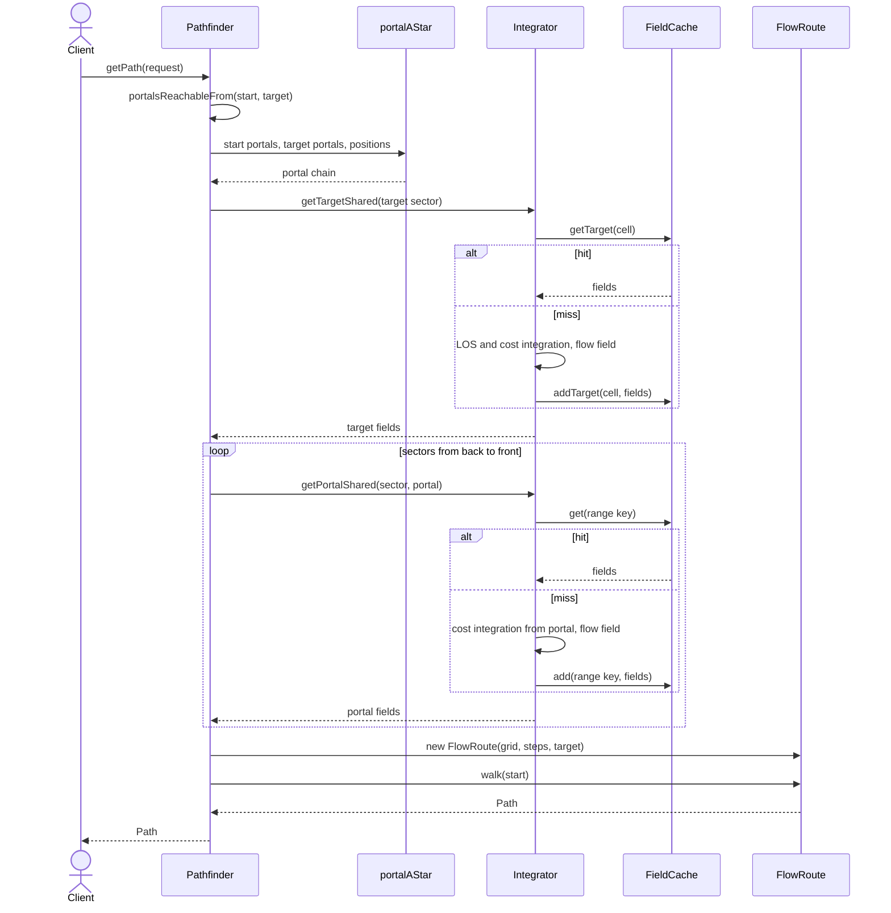

### 5.3 Stage 1: portal A\*

The nodes of the search graph are portals. Two portals are connected when they lie in the same area of a sector. The
example shows an open grid of four sectors.

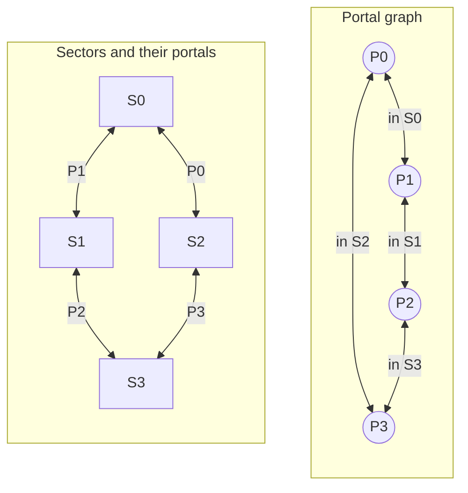

| Element     | Definition                                                                            |
| ----------- | ------------------------------------------------------------------------------------- |
| State       | Portal plus `entrySector`, the sector you arrive in after crossing it                 |
| Start       | All portals the start reaches in its own sector, `g = round(10 × distance)`           |
| Edge weight | `round(10 × distance)` between portal centers, precomputed per sector in its exit table |
| Heuristic   | `h = round(10 × distance(portal center, target))` in global coordinates               |
| Priority    | `f = g + h` in the `IntrusiveHeap`                                                    |
| Termination | As soon as a target portal is popped from the open set                                |

Search state lives in short-lived `PortalSearchNode` objects. During a search, each one hangs directly off its node via
`PortalNode.search`, which saves a per-search lookup table. A `finally` block removes these references again, even when
the search throws. Because every entry carries its own heap position, lowering a priority needs no search in the heap
either.

For an unreachable target, `portalAStar()` returns a partial route to the closest node (`partial: true`). `Pathfinder`
treats this as `NOT_FOUND`, because a partial route cannot be walked to the target.

### 5.4 Stage 2: field pipeline

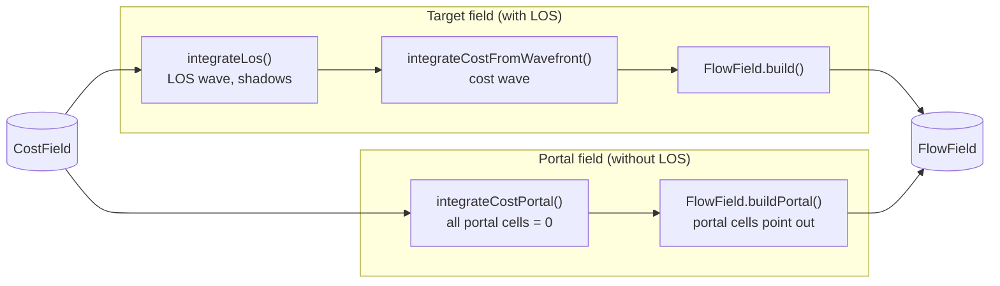

The three computation steps:

1. **LOS wave.** A breadth-first search starts at the target and marks cells with minimal cost as visible. It stops at
   the first more expensive or blocked cell. From the corners of that obstacle, `bresenhamLine()` traces the shadow edge
   and marks the cells on it as _wavefront-blocked_.
2. **Cost wave.** From these cells, cost integration spreads 4-connected. It uses a plain FIFO wave rather than a
   priority queue, so a cell can be visited several times when a cheaper value arrives later (label-correcting).
3. **Flow computation.** Each cell points to the cheapest of its 8 neighbors. Diagonals only count when both adjacent
   cardinal cells are reachable, so units do not cut corners. Ties go to the direction checked first, in the order
   N, E, S, W, NE, SE, SW, NW.

A real result for a 6×6 sector with a wall (`█`), expensive terrain (cost `5`) and the target `◎`:

```text
Cost field             Integration field      Line of sight          Flow field
 1  1  1  1  1  1       6  5  4  3  2  3      ·  ·  ·  L  L  L       →  →  →  ↘  ↓  ↙
 1  1  █  1  1  1       7  6  █  2  1  2      ·  ·  ·  L  L  L       ↗  ↑  █  ↘  ↓  ↙
 1  1  █  1  ◎  1       8  7  █  1  0  1      ·  ·  ·  L  L  L       ↗  ↑  █  →  ◎  ←
 1  1  █  1  1  1       9  8  █  2  1  2      ·  ·  ·  L  L  L       ↗  ↑  █  ↗  ↑  ↖
 1  1  5  5  1  1       8  7 10  7  2  3      ·  ·  ·  ·  L  L       ↘  ↘  ↘  ↗  ↑  ↖
 1  1  1  1  1  1       7  6  5  4  3  4      ·  ·  ·  ·  L  L       →  →  →  ↗  ↑  ↖
```

Target and portal fields differ in what makes them reusable:

| Property           | Target field                 | Portal field                      |
| ------------------ | ---------------------------- | --------------------------------- |
| Used for           | Last sector of the route     | Start and transit sectors         |
| Start cells        | The target cell              | All portal cells at cost `0`      |
| Line of sight      | Yes                          | No                                |
| Depends on target  | Yes                          | **No**                            |
| Cache key          | Cell index                   | Cell range of the portal          |
| Cache size         | At most 4 per cost field (LRU) | One per portal range and direction |

The fields of a route are **chained through the portal cells only**. Every portal field starts again at cost `0`, and
no accumulated cost flows in from the next sector. `Pathfinder` does pass on the next sector's integration field, but
without LOS it is never read. This is exactly why portal fields are independent of the target and can be shared by all
routes through the same portal.

### 5.5 Following a route

| Property           | `walk(start)`                       | `next(ne, se)`                            |
| ------------------ | ----------------------------------- | ----------------------------------------- |
| Purpose            | One path as a list of waypoints     | One step for one unit                     |
| State              | Walks the route once                | Stateless, for any number of units        |
| Repeated sector    | Follows the step index              | Takes the matching step closest to target |
| Target in sight    | Ends the walk (string pulling)      | Returns the target directly               |
| Cannot continue    | `NOT_FOUND`                         | `null`                                    |

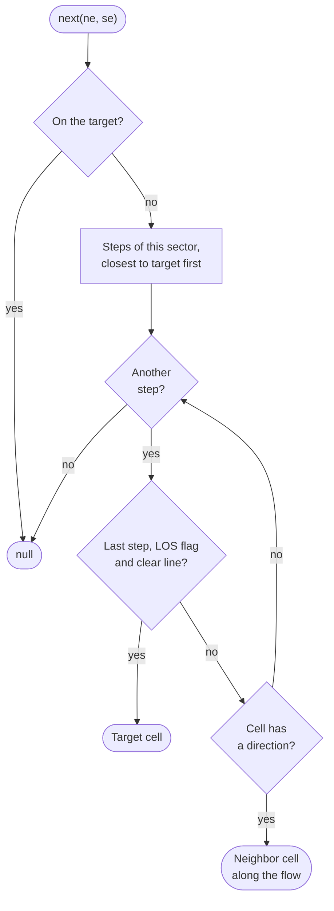

The LOS flag alone is not enough for the shortcut, because shadowcasting can graze obstacle corners. `isLineWalkable()`
therefore also checks the straight line against the current cost field.

### 5.6 Updating costs incrementally

`Grid.updateCosts()` is the intended way to change the map. Its cost depends mostly on the sectors touched. Only the
cleanup of dropped nodes runs once over all portal nodes of the grid.

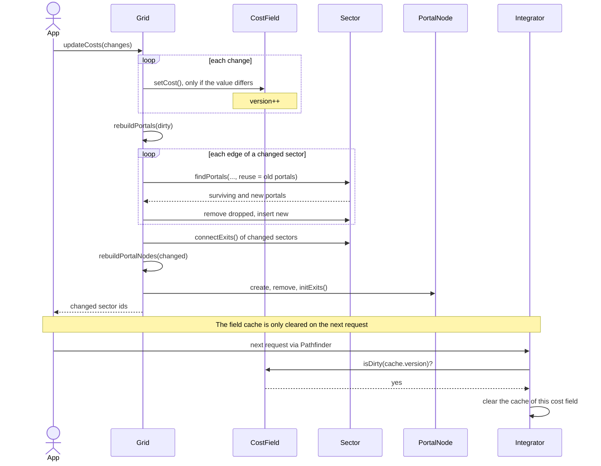

A portal whose cell range stays the same keeps its object and id. `addPortal()` sorts by edge and position, so the
portal list depends only on the state of the map. As a result, a grid updated step by step plans **the same routes** as
one built from scratch.

## 6. Caching and invalidation

| Data               | Location             | Key                | Valid until                | Bound                 |
| ------------------ | -------------------- | ------------------ | -------------------------- | --------------------- |
| Areas              | `Sector`             | –                  | Cost field version changes | One per sector        |
| Portal fields      | `FieldCache.cache`   | Portal cell range  | Cost field version changes | Number of portal ranges; optional LRU over all cost fields (`maxPortalFields`) |
| Target fields      | `FieldCache.targets` | Cell index         | Cost field version changes | LRU, 4 per cost field; optional LRU over all cost fields (`maxTargetFields`) |
| Portal center, key | `Portal`             | Portal side        | Immutable                  | Two per portal        |
| Exit distances     | Sector exit table    | Portal pair        | `connectExits()`           | k² per sector (k portals) |

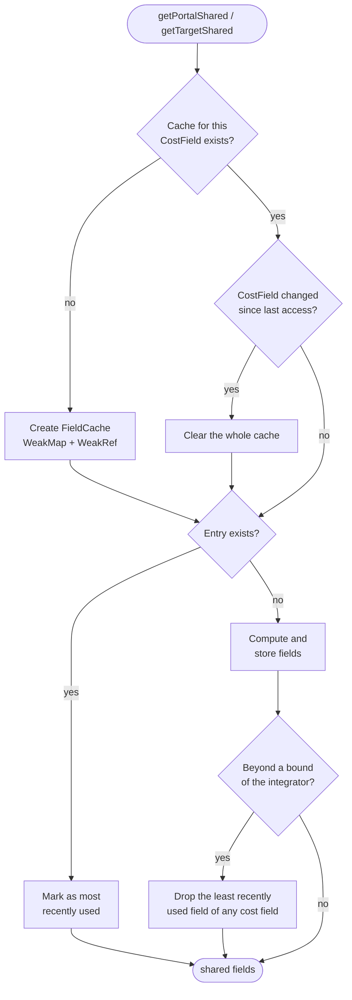

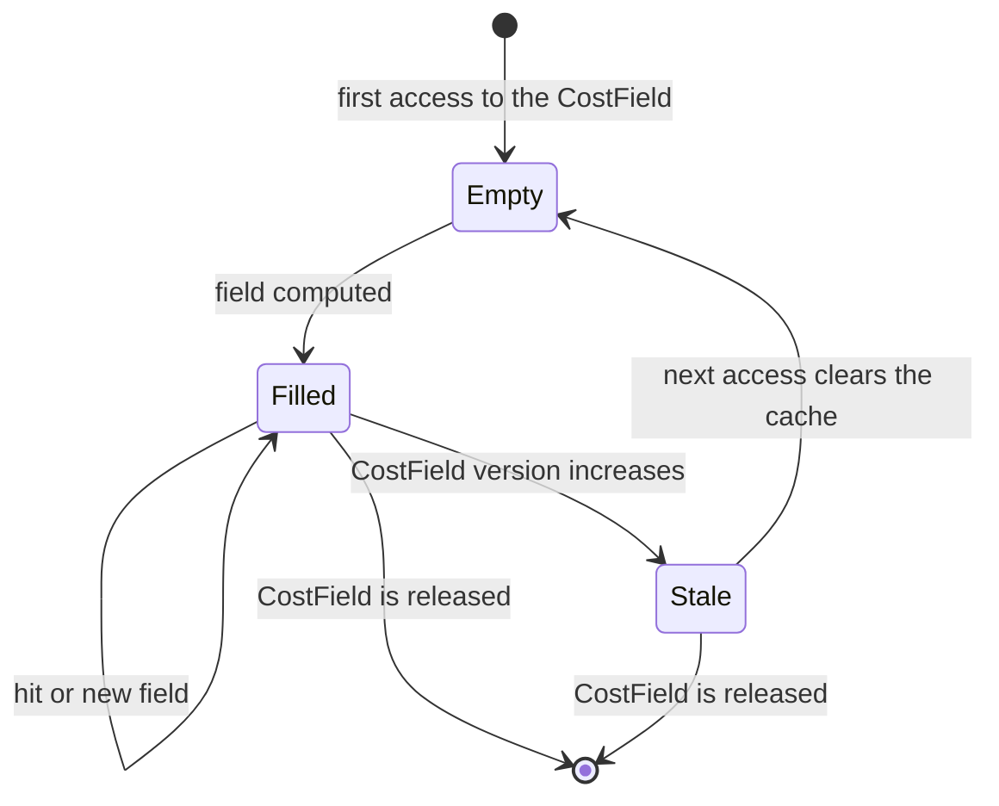

The cache is separate per `CostField`. Fields of different grids therefore cannot mix, and the cache of a replaced grid
is released along with it. The additional `WeakRef`s exist only for counting in `getCachedFieldCount()`. That value
excludes target fields (`getCachedTargetFieldCount()` counts those) and can still include stale entries after a change,
until the affected cost field is requested again.

With `maxPortalFields` or `maxTargetFields` set, the integrator also keeps one LRU per field kind over all its caches,
a `Map` from entry to cache and key in order of use. A hit moves the entry to the end, a new entry beyond the bound
drops the first one from its cache. Entries a cache drops by itself (cleared after a change, or beyond `MAX_TARGETS`)
leave the LRU too, so they do not push out live fields. Dropping is safe for determinism: a field depends only on the
cost field and the portal range or target cell, so it is computed again bit for bit. The LRU holds its entries
strongly; those of a released grid stay until newer fields push them out, which the bound limits.

The integrator offers four kinds of access:

| Method              | Cache | Returns             | LOS      | Writable |
| ------------------- | ----- | ------------------- | -------- | -------- |
| `get()`             | No    | New fields          | Optional | Yes      |
| `getTargetShared()` | Yes   | Shared fields       | Yes      | **No**   |
| `getPortalShared()` | Yes   | Shared fields       | No       | **No**   |
| `getPortal()`       | Yes   | Copy (copy-on-read) | Optional | Yes      |

## 7. Design patterns

### Structure

| Pattern                            | Implementation                                       | Benefit                                         |
| ---------------------------------- | ---------------------------------------------------- | ----------------------------------------------- |
| **Facade**                         | `Pathfinder` in front of search, integrator, routes  | One narrow API for the common case              |
| **Hierarchical decomposition**     | Grid → sector → cell, portal A\* over flow fields    | Search effort scales with portals, not cells    |
| **Pipes and filters**              | Cost → integration → flow                            | Each step has a clear input and output          |
| **Adapter**                        | `buildGrid()` for global cost arrays                 | Applications keep their own map format          |
| **Adapter**                        | `BinaryHeap` over `IntrusiveHeap`                    | Generic API, a single heap algorithm            |
| **Result object**                  | `Path` with `PathResult`, factories in `path-result.ts` | Expected failures without exceptions         |
| **Dependency injection (function)** | `findPortals(..., nextId)` takes an id allocator    | The grid stays the only source of new portal ids |

### Performance

| Pattern                  | Implementation                                       | Benefit                                         |
| ------------------------ | ---------------------------------------------------- | ----------------------------------------------- |
| **Data-oriented design** | Flat typed arrays instead of cell objects            | Compact memory, cache-friendly loops            |
| **Bit fields**           | Direction and flags in one byte                      | One byte per flow cell, as in the C++ original  |
| **Flyweight**            | Many units and routes share fields                   | Field memory and planning do not grow with units |
| **Cache-aside**          | `Integrator` checks `FieldCache`, computes on a miss | Expensive integration runs only once            |
| **LRU**                  | `FieldCache.targets` and the integrator's optional bounds via `Map` insertion order | Bounded memory for cached fields |
| **Weak references**      | `WeakMap` and `WeakRef` per `CostField`              | No manual cleanup of replaced grids             |
| **Lazy initialization**  | `Sector.getAreas()`, portal centers and range keys   | Costs arise only when needed                    |
| **Intrusive data structure** | `HeapEntry.index`, `PortalNode.search`           | Position and state access without a lookup      |

### Consistency

| Pattern                   | Implementation                                     | Benefit                                          |
| ------------------------- | -------------------------------------------------- | ------------------------------------------------ |
| **Version stamp**         | `CostField.version`, compared by cache and areas   | Invalidation without events or back references  |
| **Lazy invalidation**     | The cache is cleared on the next access            | Many changes between requests cost nothing extra |
| **Copy-on-read**          | `Integrator.getPortal()`                           | Callers may modify fields, the cache stays clean |
| **Identity preservation** | `findPortals(..., reuse)`, `Portal.spans()`        | Surviving portals keep id, exits and node        |
| **Canonical ordering**    | `Sector.addPortal()` sorts by edge and position    | Incremental and fresh grids plan identically     |
| **Canonical numbering**   | `Grid.renumberPortals()` (opt-in)                  | Incremental and fresh grids also share portal ids |
| **Snapshot**              | `FlowRoute` holds the fields from planning time    | Stable route for a group, replanning is explicit |

## 8. Contracts and invariants

For performance reasons, the package mostly does not check these rules at runtime.

| Rule                                                                   | If violated                                                  |
| ---------------------------------------------------------------------- | ------------------------------------------------------------ |
| Add sectors row-major, `id = x + y × width`                            | `getSector(x, y)` and `getSectorPosition()` return wrong sectors |
| All sectors have the same size                                         | Coordinate conversion and portals no longer line up          |
| Set all costs first, then `initPortals()`, then `initPortalNodes()`    | Missing portals or edges in the search graph                 |
| Change costs through `Grid.updateCosts()`                              | A direct `setCost()` leaves portals and exits stale          |
| Treat fields from `*Shared()` and `getSteps()` as read-only            | Writes show up in every other route                          |
| Treat `Sector.getAreas()` as read-only                                 | Reachability and portal connections become wrong             |
| Replan after a cost change                                             | An old `FlowRoute` can lead units into a new wall            |
| Never use `65535` as a real integration cost                           | Cells count as unreachable, flow fields become wrong         |

**A start on an impassable cell** is a defined special case: `getFlowRoute()` plans from the adjacent areas,
`route.next()` returns `null` on the start cell itself, and `getPath()` yields `NOT_FOUND`. A unit caught by a newly
placed wall can therefore step onto a neighboring cell and follow the route from there.

## 9. Known limits and legacy API

Anyone using or extending the package should know these properties:

- **Portal selection ignores terrain cost.** Portal A\* works with Euclidean distances. An expensive but passable
  corridor is chosen even when a longer detour over cheap cells would cost less overall. Terrain costs only take effect
  inside sectors.
- **Routes are not guaranteed to be optimal.** The search approximates each portal by its center cell and keeps a single
  state per portal.
- **`Pathfinder` routes have LOS in the target sector only.** This matches `los_depth = 1` in openage.
- **Any cell with a cost above `1` blocks line of sight**, including passable terrain.
- **Computation is synchronous.** Large updates and many first-time integrations run on the calling thread.

Some public members are no longer used by the library code. Removing them would be a breaking change:

| Area               | Members                                                                                    |
| ------------------ | ------------------------------------------------------------------------------------------ |
| `PortalNode`       | `entrySector`, `currentCost`, `heuristicCost`, `futureCost`, `wasBest`, `prevPortal`, `generateBacktrace()`, `getExits()` |
| `Portal`           | `matches()`, `getExits()`                                                                  |
| `IntegrationField` | `resetDynamicFlags()`                                                                      |
| `FlowField`        | `constructorFromIntegration()`, `resetDynamicFlags()`, unused parameter `_other`           |
| `Integrator`       | Unused parameter `_withLos` of `buildPortal()`                                             |
| `FieldCache`       | `evict()`, `isCached()`, `getIntegrationField()`, `getFlowField()`, `getCostFieldVersion()`, `setCostFieldVersion()`, `makeCacheKey()` |

## 10. The demo as a reference consumer

`apps/demo` shows the library under load and plans **no routes of its own**. Both of its parts go through the public
API:

- The **playground** (`World`) keeps one global cost layer, syncs it with `buildGrid` and `Grid.updateCosts`, and gets
  every route from `Pathfinder.getFlowRoute()`.
- The **guide** runs the real `Pathfinder` and `portalAStar` and records what they do. Its tests compare the recordings
  with the library.

Mobs standing in the same walkable area of a sector (`Sector.getAreas()`) share one `FlowRoute`, planned for the first
mob that asks for it. Each mob then gets its next cell from `FlowRoute.next()`, and a mob pushed off its route switches
to the route of the area it stands in. After a change to the target or the costs, the next planning tick assigns every
mob a route again. Sectors whose costs stayed the same reuse their cached fields.

What stays in the demo is the simulation around the routes: walls, labyrinths, moving obstacles, mob movement and local
avoidance. A mob counts as blocked when the library has no route for it. The flow overlay draws the fields of the routes
in use, so sectors no mob's route passes through show no arrows.

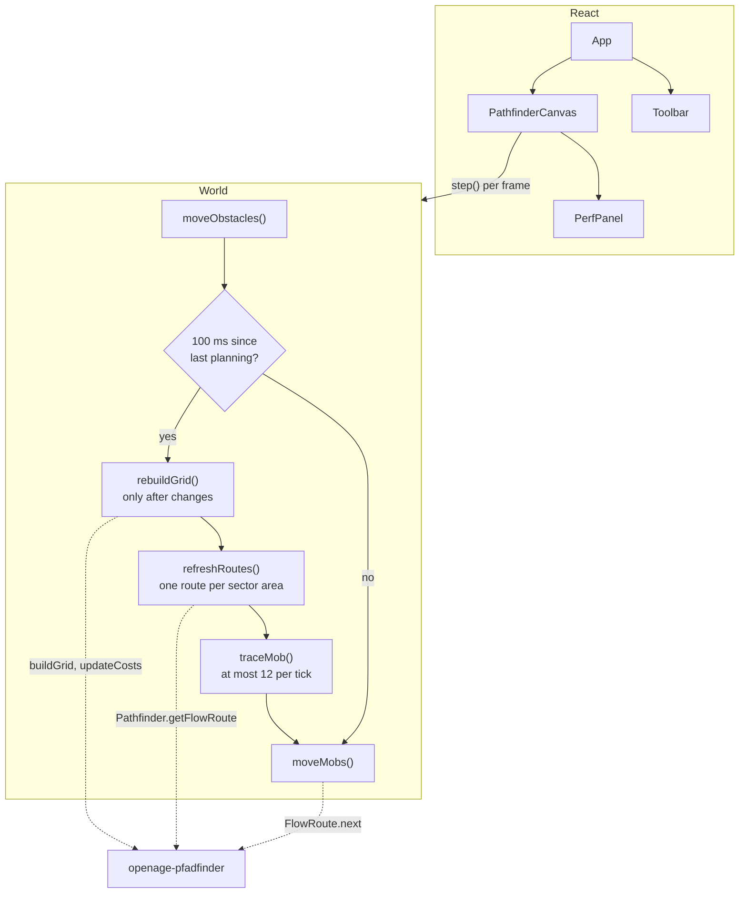

## 11. Build, quality and release

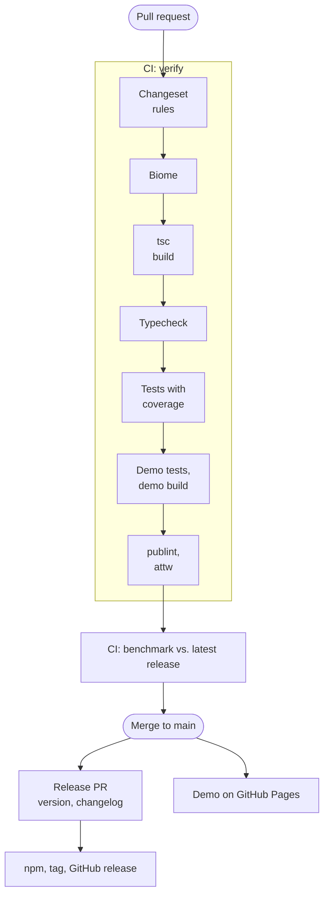

- CI only runs the steps affected by the changed files. The benchmark runs for package changes only and fails when the
  latest release is faster beyond the 5 % noise margin.
- Coverage thresholds are 90 % for statements, functions and lines, and 85 % for branches.
- TypeScript runs in strict mode, including `noUncheckedIndexedAccess`, `exactOptionalPropertyTypes` and
  `verbatimModuleSyntax`. The `!` assertions in the field loops are deliberately allowed for this reason.
- Changes to `packages/pfadfinder/src/` or `packages/pfadfinder/package.json` require a changeset, see
  [RELEASING.md](RELEASING.md).

Tests are organized by topic:

| Area             | Tests in `packages/pfadfinder/test/`                                                  |
| ---------------- | ------------------------------------------------------------------------------------- |
| Fields           | `cost-field*`, `integration-field`, `integrator-*`, `los-string-pulling`              |
| Graph            | `grid-*`, `sector-*`, `portal-entry-frames`                                           |
| Search and routes | `pathfinder`, `multi-sector`, `transit-sectors`, `partial-path`, `portal-graph-heuristic`, `portal-search-state`, `waypoints-walkable` |
| Cache            | `field-cache*`                                                                        |
| Utilities        | `binary-heap`, `bresenham`, `cost-map`, `index`                                       |

## 12. Where does a change belong?

| Goal                            | Start at                                         | Watch out for                                                |
| ------------------------------- | ------------------------------------------------ | ------------------------------------------------------------ |
| New meaning for cell costs      | `shared/constants.ts`, `IntegrationField`        | LOS treats everything above `COST_MIN` as an obstacle        |
| Portal selection by terrain cost | `Sector.connectExits()`, `portalAStar()`        | Recompute exits after cost changes, keep the heuristic admissible |
| LOS across several sectors      | `Pathfinder.getPathMultiSector()`, `getPortal()` | Fields with LOS depend on the target and must not be shared  |
| New cache level                 | `Integrator`, `FieldCache`                       | The key must cover every input of the field                  |
| New flag                        | `shared/constants.ts`                            | Keep integration and flow bits from colliding                |
| New public API                  | `src/index.ts` or `src/shared/index.ts`          | Update `docs/API.md`, add a changeset                        |
| Different map format            | `shared/cost-map`                                | Keep the row-major contract of the sectors                   |
